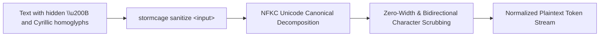

# Recipe: Unicode Normalization & Invisible Character Stripping

> **Use Case ID:** `STM-UC-02`  
> **Target Audience:** Prompt Engineers, Security Researchers, Agent Framework Authors  
> **Platform Mechanism:** NFKC Unicode Sanitizer & Steganography Filter  

---

## 1. Problem Statement

Attackers evade prompt safety filters using invisible Unicode characters (zero-width spaces `\u200B`, zero-width joiners `\u200D`, word joiners `\u2060`) and bidirectional override controls (`\u202E`). These characters are invisible to human operators looking at a terminal, but LLM tokenizers parse them into hidden instructions that bypass safety filters.

---

## 2. When to Use This

Use **`stormcage sanitize`** as a standard pre-processing filter on all external text inputs before passing them into LLM inference or agent message boards. Stormcage applies NFKC normalization, strips all zero-width characters, and neutralizes directional formatting.

---

## 3. Architecture & Dataflow



---

## 4. Prerequisites

1. **Stormcage CLI:** Available on `$PATH`.

---

## 5. Step-by-Step Recipe

### Step 1: Sanitize a String from Terminal
```bash
stormcage sanitize "Hello​World" # Contains hidden \u200b
```
Output:
```text
HelloWorld
```

### Step 2: Sanitize a Document
```bash
stormcage sanitize --file prompt.txt > sanitized_prompt.txt
```

---

## 6. Verification & Expected Output

Inspect character differences with hex dump:
```bash
printf "test\u200btest" | stormcage sanitize | xxd
```
Confirms the 3-byte UTF-8 sequence `e2 80 8b` was completely stripped.

---

## 7. Security Invariants & Blast Radius

- **Lossless Meaning Preservation:** Standard alphanumeric characters, formatting whitespace (`\n`, `\t`), and valid international languages are preserved while stripping dangerous invisible control codes.

---

## 8. Troubleshooting & Common Pitfalls

- **Issue:** International accents are altered.  
  **Remediation:** Stormcage uses standard Unicode NFKC normalization; ensure input file encoding is valid UTF-8.
