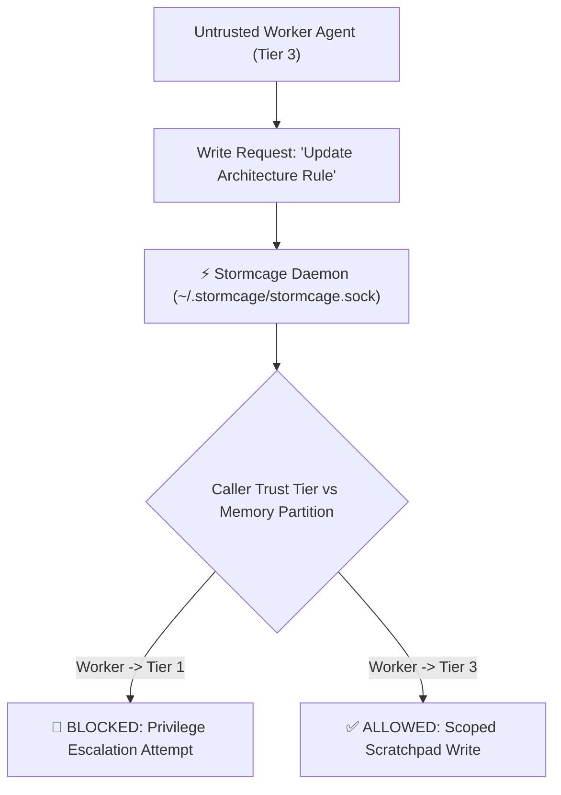

# Recipe: Compartmentalized Shared Memory Firewall Daemon

> **Use Case ID:** `STM-UC-03`  
> **Target Audience:** Multi-Agent Framework Engineers, Swarm Operators  
> **Platform Mechanism:** IPC Shared Memory Isolation Daemon  

---

## 1. Problem Statement

When running autonomous swarms where multiple agents write to a shared memory pool or blackboard (e.g. Coppermind scratchpads), untrusted worker agents can overwrite coordinator state or inject poisoned facts that manipulate the entire swarm.

---

## 2. When to Use This

Run the **Stormcage Daemon** to mediate access to shared agent memory. The daemon partitions memory spaces by trust tier (`TIER_1_CANONICAL`, `TIER_2_SYNTHESIS`, `TIER_3_UNTRUSTED`), rejecting writes from low-trust workers that attempt to overwrite canonical facts.

---

## 3. Architecture & Dataflow



---

## 4. Prerequisites

1. **Stormcage Installed:** Version 1.0+ on `$PATH`.

---

## 5. Step-by-Step Recipe

### Step 1: Start Stormcage Daemon
```bash
stormcage daemon start
```

### Step 2: Check Daemon Memory Status
```bash
stormcage status
```
Expected output:
```text
⚡ Stormcage Memory Firewall Status:
├── Active Partitions: 3 (Canonical, Synthesis, Untrusted)
├── Enforced Boundaries: Strict Partition Isolation
└── Socket: ~/.stormcage/stormcage.sock (ONLINE)
```

---

## 6. Verification & Expected Output

Attempting an unauthorized cross-tier write fails with `403 Forbidden: Cross-partition memory injection prohibited`.

---

## 7. Security Invariants & Blast Radius

- **Strict Upward Read, Downward Write Isolation:** Untrusted workers cannot write to canonical memory partitions without human coordinator sign-off.

---

## 8. Troubleshooting & Common Pitfalls

- **Issue:** Socket connection refused.  
  **Remediation:** Verify socket permissions and restart: `stormcage daemon restart`.
